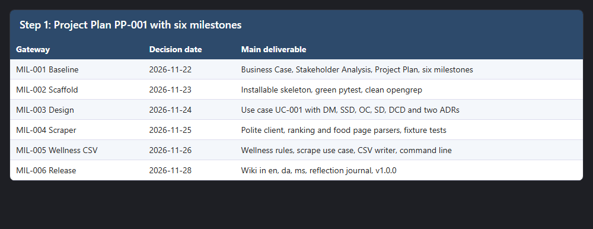
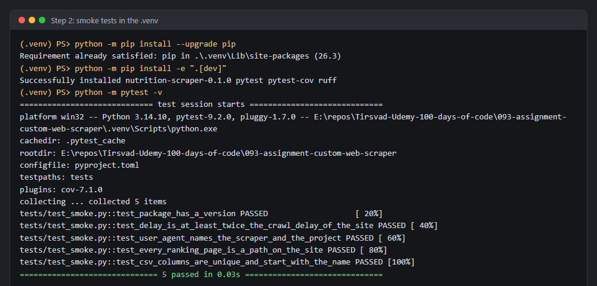
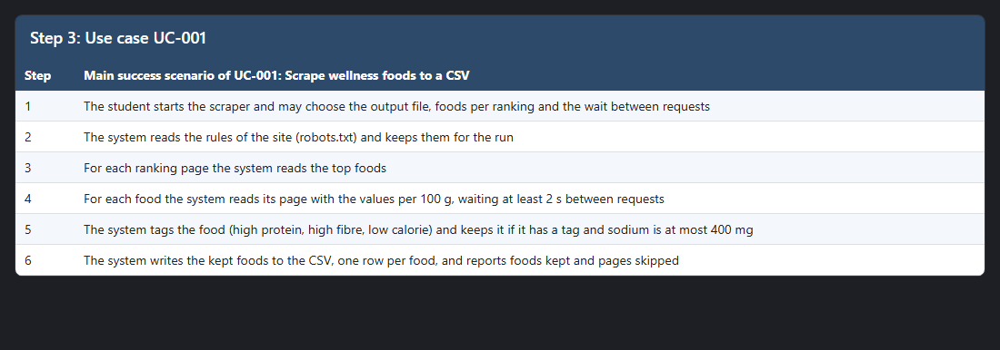
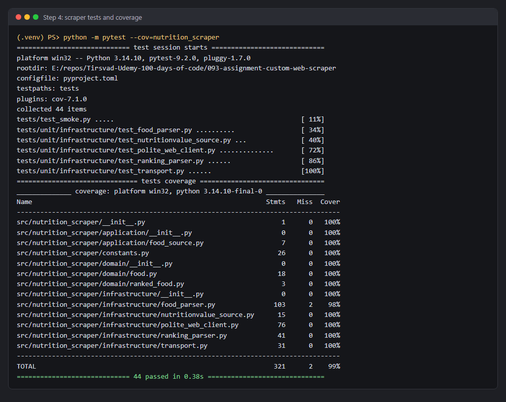

# 🚀 Nutrition Wellness Scraper

A polite command-line web scraper that collects wellness and fitness friendly
foods from [nutritionvalue.org](https://www.nutritionvalue.org/) and writes
them to a CSV file. Day 93 assignment of the 100 Days of Code Python course.

## 📚 Table of Contents

- [Overview](#-overview)
- [Requirements](#-requirements)
- [Setup](#-setup)
- [Run](#-run)
- [Tests](#-tests)
- [Steps](#-steps)
- [License](#-license)
- [Links](#-links)
- [Appendix: Project documents](#-appendix-project-documents)

## 🧭 Overview

The assignment is to scrape a website for data you are interested in and build
a CSV from it. The interest here is wellness and fitness, so the scraper looks
for foods that are high in protein, high in fibre or low in calories, and
leaves out foods that are high in sodium.

How a run works:

1. The scraper reads `https://www.nutritionvalue.org/robots.txt` and fetches
   only paths it allows.
2. It reads eight ranking pages (for example protein in fish, fibre in
   vegetables, lowest calories in fruits) and takes the top foods of each.
3. For each food it reads the food page with the values per 100 g and parses
   the name, category, calories and nutrients with `html.parser`.
4. It tags each food (`high-protein` at 20 g or more, `high-fibre` at 6 g or
   more, `low-calorie` at 60 kcal or less), drops foods with more than 400 mg
   sodium, and writes the rest to `data/wellness_foods.csv`.

Being polite is part of the design: there are at least 2 seconds between two
requests, the User-Agent names the scraper and this repository, a failed
request is repeated only twice, and the pages of the site are read only as far
as `robots.txt` allows. The scraper has no runtime dependencies; it uses
`urllib`, `html.parser` and `csv` from the standard library.

The thresholds are simple rules for study, not dietary advice.

| Folder | What it holds |
| --- | --- |
| `src/nutrition_scraper/domain/` | The `Food` value object and the wellness rules (`classify_wellness`, `is_wellness_friendly`) |
| `src/nutrition_scraper/application/` | The use case `scrape_foods` and the `FoodSource` port |
| `src/nutrition_scraper/infrastructure/` | `PoliteWebClient`, `parse_ranking_page`, `parse_food_page` and `save_to_csv` |
| `src/nutrition_scraper/__main__.py` | The command line and the composition root |
| `src/nutrition_scraper/constants.py` | Every constant: URLs, delay, User-Agent, ranking pages, thresholds, CSV columns |
| `tests/unit/`, `tests/integration/` | pytest tests; they use HTML fixtures and a fake transport and never touch the network |
| `docs/` | Project documents; `docs/images/` holds the screenshots |

The table shows the finished layout: step 2 adds the package, `constants.py`
and a smoke test, step 4 the infrastructure layer, and step 5 the domain,
application layer and the command line.

## 📋 Requirements

| Requirement | Why |
| --- | --- |
| Python 3.14 or newer | The language the project is written in |
| pytest (development only) | Runs the tests |
| Doxygen (optional) | Builds the API documentation from the source comments |

There are no runtime dependencies.

## 🛠️ Setup

Create a local virtual environment in `.venv`, upgrade pip, and install the
project with its test tools.

Linux and macOS:

```bash
python3 -m venv .venv
source .venv/bin/activate
python -m pip install --upgrade pip
python -m pip install -e ".[dev]"
```

Windows (PowerShell):

```powershell
py -3.14 -m venv .venv
.venv\Scripts\Activate.ps1
python -m pip install --upgrade pip
python -m pip install -e ".[dev]"
```

Leave the environment with `deactivate`. The `.venv` folder is in `.gitignore`.

## ▶️ Run

With the virtual environment active:

```bash
python -m nutrition_scraper
```

A full run reads about 80 pages and takes a few minutes because of the delay.
Options:

| Option | Default | Meaning |
| --- | --- | --- |
| `--output PATH` | `data/wellness_foods.csv` | The CSV file to write |
| `--limit N` | 10 | Foods taken from the top of each ranking page |
| `--delay SECONDS` | 2.0 | Wait between two requests; values below 2 are raised to 2 |

`nutrition-scraper` is a shortcut for the same command. The CSV is created on
your computer and is in `.gitignore`: the terms of the site do not allow its
content to be republished, so keep the file for your own study.

## 🧪 Tests

```bash
python -m pytest
```

With coverage: `python -m pytest --cov=nutrition_scraper`.

The tests use small HTML snippets written for the tests and a fake transport;
no test reads a file outside the repository or uses the network.

Build the API documentation (optional): run `doxygen` in the repository root and
open `docs/doxygen/html/index.html`.

## 🪜 Steps

The project is built in steps, one branch and pull request each. The wiki has a
page per step that explains what was learned, in English, Danish and Bahasa
Melayu, and a [reflection journal](docs/reflection.md).

<!-- steps:start -->
| Step | Milestone | What it adds | Screenshot | Wiki |
| --- | --- | --- | --- | --- |
| 1 | MIL-001 Baseline | Business case, stakeholders, project plan and milestones | [01-baseline.png](docs/images/01-baseline.png) | [Step 1](https://git.tirsystem.com/Tirsvad-Udemy-100-days-of-code/093-assignment-custom-web-scraper/wiki/Step-1-Baseline) |
| 2 | MIL-002 Scaffold | `pyproject.toml`, `constants.py`, smoke test, `.gitignore`, `.editorconfig`, `Doxyfile`, this README | [02-scaffold-tests.png](docs/images/02-scaffold-tests.png) | [Step 2](https://git.tirsystem.com/Tirsvad-Udemy-100-days-of-code/093-assignment-custom-web-scraper/wiki/Step-2-Scaffold) |
| 3 | MIL-003 Design | Use case UC-001, two ADRs, domain model, system sequence diagram, operation contract, sequence diagram, design class diagram | [03-design-use-case.png](docs/images/03-design-use-case.png) | [Step 3](https://git.tirsystem.com/Tirsvad-Udemy-100-days-of-code/093-assignment-custom-web-scraper/wiki/Step-3-Design) |
| 4 | MIL-004 Scraper | `PoliteWebClient`, `parse_ranking_page`, `parse_food_page` and their unit tests | [04-scraper-tests.png](docs/images/04-scraper-tests.png) | [Step 4](https://git.tirsystem.com/Tirsvad-Udemy-100-days-of-code/093-assignment-custom-web-scraper/wiki/Step-4-Scraper) |

Step 1, the Project Plan with six milestones:



Step 2, smoke tests passing in the .venv:



Step 3, use case UC-001:



Step 4, scraper tests with 99 % coverage:


<!-- steps:end -->

## 📄 License

GNU Affero General Public License v3.0 or later, see [LICENSE](LICENSE).

## 🔗 Links

- [Repository][repository]
- [Documentation][documentation]
- [Issue tracker][issues]

## 📎 Appendix: Project documents

| Document | What it tells you |
| --- | --- |
| [AGENTS.md][agents] | The rules agents follow in this repository |
| [Business Case][BC-001] | Why the project exists, its scope and success criteria |
| [Stakeholder Analysis][SA-001] | Who is involved; the stakeholder IDs used for owners and reviewers |
| [Project Plan][PP-001] | The gateways and their schedule |
| [Milestones][milestones] | One document per gateway: Go/No-Go criteria and tasks |
| [Artifact registry][registry] | Where each artifact type lives, the next version, the PO language and domain |
| [Framework README][framework-readme] | The framework this project uses |
| [Framework changelog][framework-changelog] | What changed in each framework release |

---

[repository]: https://git.tirsystem.com/Tirsvad-Udemy-100-days-of-code/093-assignment-custom-web-scraper
[documentation]: https://git.tirsystem.com/Tirsvad-Udemy-100-days-of-code/093-assignment-custom-web-scraper/wiki
[issues]: https://git.tirsystem.com/Tirsvad-Udemy-100-days-of-code/093-assignment-custom-web-scraper/issues
[agents]: ./AGENTS.md
[BC-001]: ./docs/business-case.md
[SA-001]: ./docs/stakeholder-analysis.md
[PP-001]: ./docs/project-plan.md
[milestones]: ./docs/milestones/
[registry]: ./docs/artifact-registry.md
[framework-readme]: ./framework/README.md
[framework-changelog]: ./framework/CHANGELOG.md
