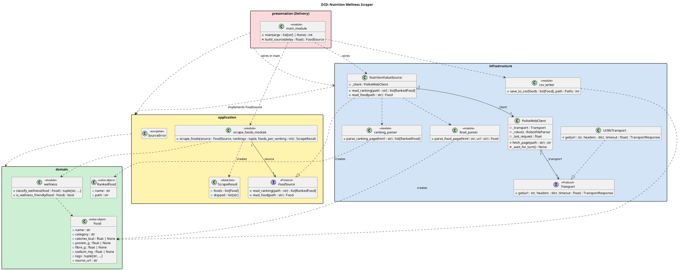

# Design Class Diagram: Nutrition Wellness Scraper

## Metadata

| Key | Value |
| --- | --- |
| ID | DCD-002 |
| CrossReference | [DCD-001], [DM-002], [SD-001], [OC-001] |

## Version History

| Date | Status | Author | Reviewer | Change | Commit |
| --- | --- | --- | --- | --- | --- |
| 2026-11-21 | Proposed | S01 | S01 | First edition: adds the design of DCD-001 (UC-001) | [b428560] |
| 2026-11-21 | Accepted | S01 | S01 | Accepted after review RC-019 Go; stand-in review, not independent | [b428560] |

---

## Purpose

The project Design Class Diagram, the consolidated design of every use case. It
holds the additions of [DCD-001] (UC-001): the classes, functions and packages
that implement [UC-001], one package per clean architecture layer. Answers
CN-003 and CN-005 for S02 and S03.

## Diagram

## Mapping to the Domain Model

| Domain concept | Design element |
| --- | --- |
| Site Rule | `RobotFileParser` inside `PoliteWebClient`; `REQUEST_DELAY_SECONDS` |
| Ranking | `RankedFood` entries returned by `parse_ranking_page`; the ranking paths are `RANKING_PAGES` |
| Food | `Food` |
| Nutrition Facts | the numeric fields of `Food`, each `None` when the page gives no value |
| Wellness Tag | the strings in `Food.tags`, set by `classify_wellness` |
| Wellness List | `ScrapeResult.foods`, written by `save_to_csv` |

## Design Notes

- Dependencies point inward: `domain` imports nothing from the other layers;
  `application` owns the `FoodSource` protocol (dependency inversion);
  `infrastructure` implements it; `main` wires the parts (composition root).
- `PoliteWebClient` has one job, a polite fetch; parsing is in separate modules
  (single responsibility).
- Every constant lives in `constants.py` (delay, User-Agent, thresholds, ranking
  pages, CSV columns).
- Exceptions: `SourceError` (application) is raised by the source for a refused,
  failed or empty page; it extends `ValueError`.

---

[DCD-001]: use-cases/uc-001-scrape-wellness-foods/dcd.md
[DM-002]: domain-model.md
[SD-001]: use-cases/uc-001-scrape-wellness-foods/sd.md
[OC-001]: use-cases/uc-001-scrape-wellness-foods/oc.md
[UC-001]: use-cases/uc-001-scrape-wellness-foods/uc.md
[b428560]: https://git.tirsystem.com/Tirsvad-Udemy-100-days-of-code/093-assignment-custom-web-scraper/commit/b428560f5990f764f9eedcb41f3ec4d3abbaca99
