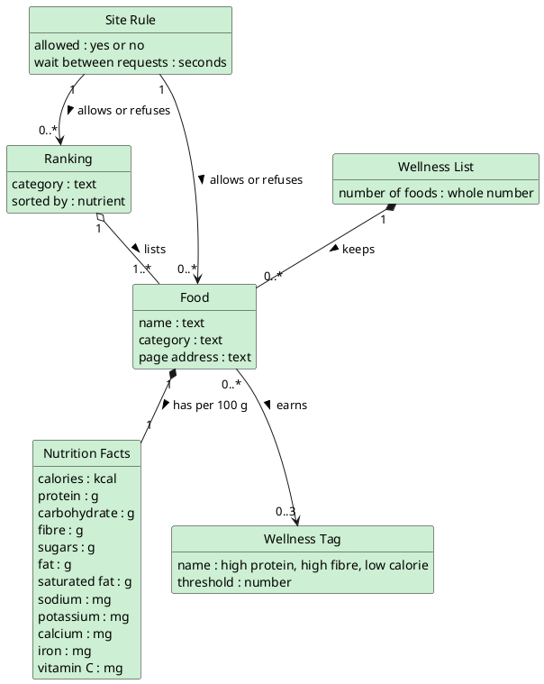

# Domain Model: Nutrition Wellness Scraper

## Metadata

| Key | Value |
| --- | --- |
| ID | DM-002 |
| CrossReference | [DM-001], [UC-001] |
| Language | en |
| Domain | it |

## Version History

| Date | Status | Author | Reviewer | Change | Commit |
| --- | --- | --- | --- | --- | --- |
| 2026-11-21 | Proposed | S01 | S01 | First edition: adds the concepts of DM-001 (UC-001) | [b428560] |
| 2026-11-21 | Accepted | S01 | S01 | Accepted after review RC-018 Go; stand-in review, not independent | [b428560] |

---

## Purpose

The project Domain Model: the concepts of every use case in the student's
words. It holds the additions of [DM-001] (UC-001), the only use case, so the
design and the code name things the way S02 participants read them (CN-003,
CN-004).

## Diagram

## Concepts

| Concept | Meaning | Source |
| --- | --- | --- |
| Site Rule | What the site allows the scraper to read and how long to wait between requests | UC-001 step 2, BR-1, BR-3 |
| Ranking | A page that lists foods of one category sorted by one nutrient, best first | UC-001 step 3, BR-2 |
| Food | One food with its name, category and the address of its page | UC-001 step 4 |
| Nutrition Facts | The values of one food per 100 g; a value the page does not give is empty | UC-001 step 4, BR-6 |
| Wellness Tag | High protein, high fibre or low calorie, earned when a value passes its threshold | UC-001 step 5, BR-4 |
| Wellness List | The foods that were kept, each once, written to the CSV | UC-001 steps 5 and 6, BR-5, BR-7 |

---

[DM-001]: use-cases/uc-001-scrape-wellness-foods/dm.md
[UC-001]: use-cases/uc-001-scrape-wellness-foods/uc.md
[b428560]: https://git.tirsystem.com/Tirsvad-Udemy-100-days-of-code/093-assignment-custom-web-scraper/commit/b428560f5990f764f9eedcb41f3ec4d3abbaca99
