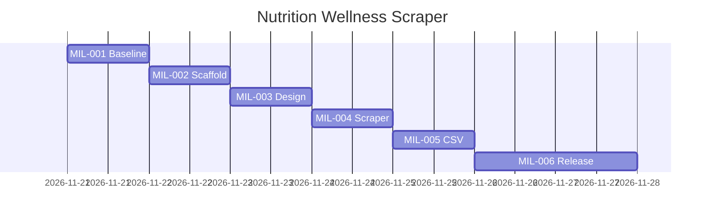

# Project Plan: Nutrition Wellness Scraper

## Metadata

| Key | Value |
| --- | --- |
| ID | PP-001 |
| CrossReference | [BC-001], [SA-001], [MIL-001], [MIL-002], [MIL-003], [MIL-004], [MIL-005], [MIL-006] |
| Language | en |
| Domain | it |

## Version History

| Date | Status | Author | Reviewer | Change | Commit |
| --- | --- | --- | --- | --- | --- |
| 2026-11-21 | Proposed | S01 | S01 | First edition: six milestones, one branch and pull request each | [06512d9] |
| 2026-11-21 | Accepted | S01 | S01 | Accepted by S01 in chat on 2026-11-21; review RC-003 Go, stand-in, not independent | [06512d9] |

---

## Window and Constraint

- Start: 2026-11-21. End: 2026-11-28.
- Constraint: the course budget of 120 minutes for the build (BC-001
  Cost-Benefit), plus documentation time; one developer (S01).

## Schedule

| Gateway | Document | Decision date | Owner | Reviewer | Main deliverable | User stories | Issue-tracker milestone |
| --- | --- | --- | --- | --- | --- | --- | --- |
| MIL-001 Baseline | [MIL-001] | 2026-11-22 | S01 | S01 | BC-001, SA-001, PP-001 and MIL-001 to MIL-006, each with a `Go` review record | none (planning) | not yet synced |
| MIL-002 Scaffold | [MIL-002] | 2026-11-23 | S01 | S01 | A repository that installs into a `.venv`, runs a small pytest suite green and passes opengrep | none (technical tasks) | not yet synced |
| MIL-003 Design | [MIL-003] | 2026-11-24 | S01 | S01 | UC-001 with its DM, SSD, OC, SD and DCD, and ADRs for the standard-library client and the wellness thresholds, each with a `Go` review | UC-001 (use case instead of stories) | not yet synced |
| MIL-004 Scraper | [MIL-004] | 2026-11-25 | S01 | S01 | A polite HTTP client that obeys `robots.txt`, parsers for ranking pages and food pages, and unit tests with HTML fixtures | UC-001 | not yet synced |
| MIL-005 Wellness Csv | [MIL-005] | 2026-11-26 | S01 | S01 | `python -m nutrition_scraper` writes `data/wellness_foods.csv`, with unit and integration tests | UC-001 | not yet synced |
| MIL-006 Release | [MIL-006] | 2026-11-28 | S01 | S01 | The complete wiki in en, da and ms, the reflection journal, the final README and a tagged release | none (documentation) | not yet synced |

## Scope Coverage

| Business Case in-scope item | Gateway |
| --- | --- |
| Read `robots.txt`, delay between requests | MIL-004 |
| Fetch ranking pages and food pages | MIL-004 |
| Parse the nutrition values | MIL-004 |
| Keep wellness-friendly foods | MIL-005 |
| Write the CSV | MIL-005 |
| Unit tests | MIL-004, MIL-005 |
| Project files, doxygen, README | MIL-002 |
| Wiki, screenshots, reflection | every milestone (step page), MIL-006 (complete) |
| Repository description and topics | MIL-001 (create), MIL-006 (check) |

## Dependencies

MIL-001 -> MIL-002; MIL-001 -> MIL-003 -> MIL-004 -> MIL-005 -> MIL-006;
MIL-002 -> MIL-004. The chain is acyclic and matches the schedule order.

## No-Go Rule

A No-Go stops the gateway; its findings are fixed on the same branch and the
gateway is reviewed again. Later gateways move by the same number of days.
The end date may move up to 7 days; S01 decides any move. Three No-Go rounds on
the same gateway stop the run and go to S01 for a decision.

## Way of Working

- One branch `milestone/mil-NNN-<slug>` and one pull request per milestone,
  closing its issues.
- Before each push: `pytest`, then opengrep on S01's computer
  (`~\.opengrep\cli\latest\opengrep.exe scan .`), 0 findings required.
- Each milestone adds its screenshot to `docs/images/`, the README step list
  and a wiki step page in en, da and ms.
- The scraper is run only against pages `robots.txt` allows, with a delay of
  at least 2 s; scraped data stays on the local computer.
- Tokens are read from `.env` by the tools only; `.env` is never committed,
  imported or tested.

## Planning Assumptions

| ID | Assumption | Source |
| --- | --- | --- |
| PA-1 | One gateway per working day is enough for this small scope | BC-001 Cost-Benefit |
| PA-2 | Pushing to git.tirsystem.com and running opengrep happen on S01's computer | Project goal (opengrep path), host reachable only from there |
| PA-3 | Python 3.14 is installed on S01's computer | BC-001 AS-6 |
| PA-4 | nutritionvalue.org stays reachable and keeps its page layout during the project | BC-001 R-1 |

## Plan Risks

| ID | Risk | Impact | Mitigation | From |
| --- | --- | --- | --- | --- |
| PR-1 | The design gateway takes longer than the code it describes | Schedule slip | One use case, short artifacts | BC-001 R-5 |
| PR-2 | The git host or opengrep is not reachable when a push is due | Gateway waits | Work continues on the next branch locally; push when reachable | PA-2 |
| PR-3 | Translations lag behind the English pages | QC-WIKI-001 fails | A step page is not done until all three languages exist | BC-001 R-5 |
| PR-4 | The site changes its layout before the live run | Live run yields no rows | Parser fixtures document the expected layout; the live run is repeated and the parser fixed on the same branch | BC-001 R-1 |

## Open Issues

None. OI-1 (prompt log) was closed on 2026-11-21: S01 accepted the plan with the proposal, so this repository keeps no prompt log.

---

[BC-001]: ./business-case.md
[SA-001]: ./stakeholder-analysis.md
[MIL-001]: ./milestones/mil-001-baseline.md
[MIL-002]: ./milestones/mil-002-scaffold.md
[MIL-003]: ./milestones/mil-003-design.md
[MIL-004]: ./milestones/mil-004-scraper.md
[MIL-005]: ./milestones/mil-005-wellness-csv.md
[MIL-006]: ./milestones/mil-006-release.md
[06512d9]: https://git.tirsystem.com/Tirsvad-Udemy-100-days-of-code/093-assignment-custom-web-scraper/commit/06512d9089fccc9f33f90b9cdce559fe9d1d7411
