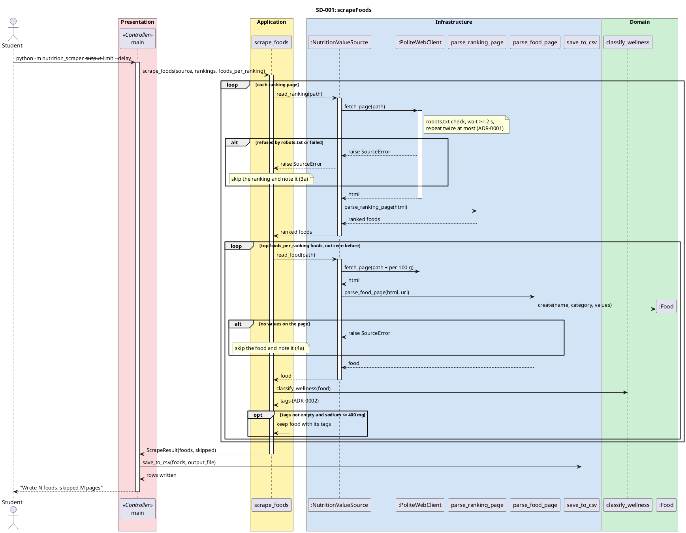

# Sequence Diagram: scrapeFoods

## Metadata

| Key | Value |
| --- | --- |
| ID | SD-001 |
| CrossReference | [OC-001], [DCD-001], [ADR-0001], [ADR-0002] |

## Version History

| Date | Status | Author | Reviewer | Change | Commit |
| --- | --- | --- | --- | --- | --- |
| 2026-11-21 | Proposed | S01 | S01 | First edition | [d5d3287] |
| 2026-11-21 | Accepted | S01 | S01 | Accepted after review RC-016 Go; stand-in review, not independent | [d5d3287] |

---

## Purpose

How the classes realise the postconditions of [OC-001] `scrapeFoods`, grouped by
the clean architecture layers. Answers CN-003 (readable names) and CN-008 (where
the politeness is enforced) for S02 and S04.

## Diagram

## Notes

- GRASP Controller: `main` receives the system operation and only delegates;
  `scrape_foods` is the use case controller.
- The application layer owns the `FoodSource` protocol; `NutritionValueSource`
  implements it, so the use case is tested with a fake source and no network.
- The politeness (robots, delay, repeats) lives in one place, `PoliteWebClient`,
  and every request goes through it.
- The exceptions of OC-001 are the `alt` fragments; a skipped page is added to
  `ScrapeResult.skipped` and the run continues.

---

[OC-001]: oc.md
[DCD-001]: dcd.md
[ADR-0001]: ../../adr/adr-0001-standard-library-client.md
[ADR-0002]: ../../adr/adr-0002-wellness-thresholds.md
[d5d3287]: https://git.tirsystem.com/Tirsvad-Udemy-100-days-of-code/093-assignment-custom-web-scraper/commit/d5d328712110d0af9ce8e36a84913faaf3e35d0b
