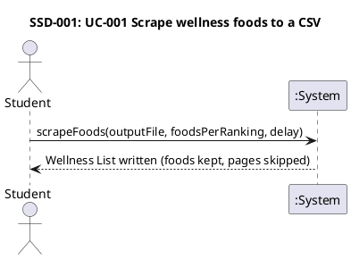
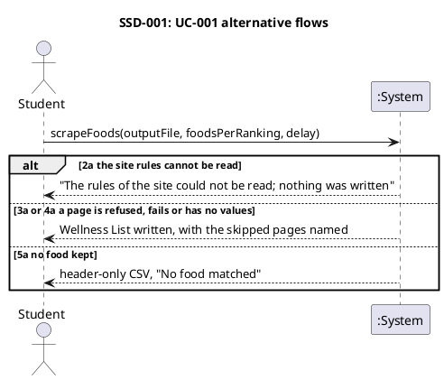

# System Sequence Diagram: UC-001 Scrape wellness foods to a CSV

## Metadata

| Key | Value |
| --- | --- |
| ID | SSD-001 |
| CrossReference | [UC-001], [DM-001], [OC-001] |
| Language | en |
| Domain | it |

## Version History

| Date | Status | Author | Reviewer | Change | Commit |
| --- | --- | --- | --- | --- | --- |
| 2026-11-21 | Proposed | S01 | S01 | First edition | [d5d3287] |
| 2026-11-21 | Accepted | S01 | S01 | Accepted after review RC-014 Go; stand-in review, not independent | [d5d3287] |

---

## Purpose

The system operations of [UC-001] Scrape wellness foods to a CSV, with the
system as a black box.

## Main Success Scenario

Step 1 of UC-001 is the `scrapeFoods` message; steps 2 to 6 are the work of the
system and its return. The reading of the site (steps 2 to 4) is a conversation
between the system and the site, which is not an actor of this diagram because
the student does not take part in it.

## Alternative Flows

Flow 6a needs no own diagram: the system creates the folder and the return is
the same as in the main scenario.

---

[UC-001]: uc.md
[DM-001]: dm.md
[OC-001]: oc.md
[d5d3287]: https://git.tirsystem.com/Tirsvad-Udemy-100-days-of-code/093-assignment-custom-web-scraper/commit/d5d328712110d0af9ce8e36a84913faaf3e35d0b
